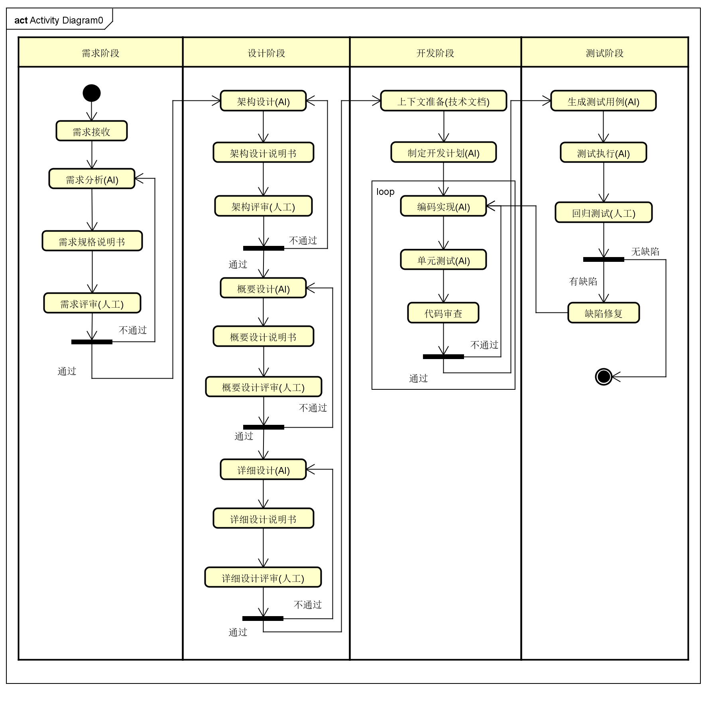

# AI 参与开发项目全流程

> 状态：**草稿 v5（待确认）**
> 用途：对上汇报 AI 开发模式的使用方式，作为是否推广的参考依据。
>
> 流程结构以流程图为准，本文档只说明各环节的具体要求：
>
> 

---

## 一、需求阶段

**需求接收（人工）**：接收原始需求，记录需求描述与业务背景。

**需求分析（AI）**：要求 AI 整理原始需求，澄清模糊点、指出遗漏与矛盾，输出问题清单（每条附 AI 的推测与建议确认方向）；不确定内容标注"待确认"，禁止自行编造。

**需求规格说明书SRS（AI 生成）**：要求 AI 基于澄清后的需求生成需求规格说明书SRS，说明书中应包括：

- 功能需求：以用户故事组织功能描述；当需求参与者与用例较多、交互关系比较复杂时，要求 AI 生成 Use Case 图；当核心业务流程步骤较多、跨多个角色时，要求 AI 生成业务流程图（活动图）；当流程涉及多角色协作、需要明确各角色职责时，要求 AI 生成泳道图（带泳道的活动图）；
- 数据流：当系统与外部系统、角色间的数据交换较多、数据加工链路比较复杂时，要求 AI 生成数据流图DFD（顶层与分层），标明数据的来源、加工与去向；
- 非功能需求：性能、安全、兼容性、可维护性等；
- 边界与异常场景、输入输出、约束条件；
- 每条功能需求应写明**验收标准**（可测试），并编号以便后续设计与测试用例TC追溯。

**需求评审（人工）**：对照原始需求逐条检查 SRS——功能覆盖完整、范围明确（做什么/不做什么）、验收标准可测试；不通过则注明问题，回到需求分析。

---

## 二、设计阶段

**架构设计（AI）**：要求 AI 根据 SRS 与现有技术栈，给出 2~3 个候选方案并对比优劣、风险与依赖，生成架构设计说明书ADS，说明书中应包括：

- 总体架构：分层/组件划分、各模块职责与边界；当系统模块较多、结构比较复杂时，要求 AI 生成组件图表达模块划分与依赖关系；
- 技术选型及理由，对 SRS 中关键约束（性能、安全、扩展性）的满足方式；
- 关键业务流程的数据流与流转；当流程跨多个模块、含异步调用或分支较多、比较复杂时，要求 AI 生成时序图/活动图；
- 与现有系统的集成方式、部署视图；当部署结构（多节点、集群、多环境）比较复杂时，要求 AI 生成部署图。

**架构评审（人工）**：检查架构是否满足 SRS 约束、与现有系统集成是否可行、选型团队是否能驾驭；不通过则注明原因，回到架构设计。

**概要设计（AI）**：要求 AI 根据定稿的 ADS 进行概要设计，将系统拆分为子系统/模块，生成概要设计说明书HLD，说明书中应包括：

- 模块划分：各模块职责与边界、模块间依赖关系；当模块较多、依赖关系比较复杂时，要求 AI 生成组件图/包图表达模块结构；
- 模块间关键接口与数据契约；当模块间交互流程比较复杂时，要求 AI 生成时序图；
- 公共数据结构与共享资源的分配；当核心数据实体及其关系比较复杂时，要求 AI 生成 E-R 图（实体关系图）。

**概要设计说明书HLD（AI 生成）**：要求 AI 基于概要设计生成概要设计说明书HLD；人工修订定稿，核对模块划分与边界是否清晰、职责是否单一、关键接口与 ADS 是否一致。

**概要设计评审（人工）**：检查模块划分与关键接口是否合理、与 ADS 一致、是否覆盖 SRS 全部功能点；不通过则注明原因，回到概要设计，通过后进入详细设计。

**详细设计（AI）**：要求 AI 根据定稿的概要设计说明书HLD，细化各模块内部实现，生成详细设计说明书LLD，说明书中应包括：

- 各模块内部逻辑流程与类/函数划分；当核心业务对象与数据模型比较复杂时，要求 AI 生成类图，当模块内部处理逻辑分支较多时，要求 AI 生成逻辑流程图；
- 接口定义：地址、入参、出参、错误码；当跨模块交互的关键流程比较复杂时，要求 AI 生成时序图；
- 数据库表结构：字段名、类型、含义、索引；
- 异常处理方式；当对象状态较多、状态流转规则比较复杂时，要求 AI 生成状态图（状态机图）。

**详细设计评审（人工）**：检查设计是否完整到可直接编码、与 HLD 一致、接口与表结构前后无矛盾；不通过则回到详细设计。

---

## 三、开发阶段

**上下文准备（人工主导，部分环节 AI 辅助）**：让 AI 建立对项目的完整认知，编码开始前完成以下准备：

1. **Agent 智能体准备**：根据项目实际技术栈，选择合适技能线的智能体（Agent）——前端项目选择对应框架（React/Vue 等）技能线的 Agent，后端项目选择对应语言与框架（Java/Spring、Python 等）技能线的 Agent；多技术栈项目按子项目分别指定。确保所选 Agent 具备对应技术栈的编码规范、脚手架与调试能力。

2. **开发文档准备**：通过工具生成项目技术文档，供 AI 与后续成员使用（命令为示例，按实际工具调整）——
   - 通过 `npx clawdocs generate --depth standard` 生成文档清单（例）；
   - 通过 `claude ".clawdocs/generate-docs.md"` 生成技术文档（例）；
   - 人工审核生成的文档，补全 AI 无法获知的内容：内部系统依赖、账号权限、环境信息等。

3. **项目上下文文件准备**：编写/更新项目上下文文件（如 `CLAUDE.md`）——项目结构说明、技术栈与版本、编码规范、构建与测试命令、目录约定；规范文件随项目演进持续更新。

4. **设计文档就位**：将需求规格说明书SRS、架构设计说明书ADS、概要设计说明书HLD、详细设计说明书LLD放到 AI 可读取的位置（如 `docs/` 目录），建立需求条目-设计模块的对应关系，便于编码时按任务引入相应设计。

5. **环境基线验证**：编码开始前验证项目基线可用——依赖可安装、构建可通过、已有测试可运行，确保 AI 编码从一个"绿色"基线开始，避免把环境问题误判为代码问题。

**制定开发计划（AI）**：要求 AI 根据详细设计说明书LLD与本次任务范围，生成分步开发计划DP——将任务拆分为可独立验证的编码步骤（每步对应一个模块/功能点），每步注明：输入（对应的详细设计章节）、产出（代码与单元测试）、验证方式（构建/测试命令）；步骤按依赖关系排序，风险较高的步骤单独标注。计划经人工确认后作为编码实现的执行依据。

**编码实现（AI）**：按已确认的开发计划DP逐任务执行；要求 AI 严格遵循详细设计说明书LLD与项目规范，每步自测（编译/运行通过）后再继续；当某步骤涉及复杂算法或业务逻辑比较复杂时，要求 AI 先生成伪代码/流程图，人工确认后再编码；禁止改动无关代码、自行引入新依赖。人工跟进每步产出、验证自测结果、及时纠偏。

**单元测试（AI）**：要求 AI 为新增代码生成单元测试，覆盖正常、边界、异常三类场景，外部依赖一律 mock，断言必须真实验证行为，交付前全部跑通并汇报覆盖率。人工检查覆盖遗漏、补充关键业务场景用例。

**代码审查（AI 初审 + 人工把关）**：要求 AI 以审查者视角输出问题清单——逻辑错误、与设计偏离、规范违反、安全隐患（敏感信息硬编码、注入风险）、性能隐患，每条注明位置与修改建议；人工复核剔除误报，重点把关业务逻辑正确性与涉密信息。审查不通过回到编码实现，与编码实现、单元测试构成迭代循环（图中 loop），通过后进入测试阶段。

---

## 四、测试阶段

**生成测试用例TC（AI）**：要求 AI 根据 SRS 与详细设计说明书LLD生成测试用例TC，覆盖全部功能点及边界、异常场景（禁止只覆盖正常流程）；每条用例包含编号、前置条件、操作步骤、预期结果、对应的 SRS 需求条目编号；当对象状态流转比较复杂时，要求 AI 基于状态图生成状态迁移测试用例，当业务规则涉及多条件组合、比较复杂时，要求 AI 生成判定表组织测试场景。人工补充业务特有场景，核对用例与需求条目对应关系完整。

**测试执行（AI）**：要求 AI 优先编写自动化脚本执行用例，输出结果汇总（通过/失败/阻塞），失败项附初步定位信息（日志、堆栈、疑似原因）。人工确认执行环境正确、抽查结果真实性、整理缺陷清单。

**回归测试（人工）**：人工执行测试并确认结果——按测试用例验证功能正确性；发现缺陷则进入缺陷修复，缺陷修复后确定回归范围（受影响模块），重新执行相关用例，确认修复有效且未引入新问题。判定：无缺陷则全流程结束，有缺陷则进入缺陷修复。

**缺陷修复（AI 辅助）**：提供缺陷现象、复现步骤、日志，要求 AI **先输出定位分析**（疑似原因、涉及代码位置），人工确认后再修改；要求修复遵循原设计，完成后说明影响范围。修复完成后回到回归测试重新验证，直至无缺陷，全流程结束。

---

## 五、管控与规范

**人工把关节点（强制）**：需求评审、架构评审、概要设计评审、详细设计评审、代码审查、回归测试——以上节点由人工决策，AI 产物仅作为输入，不得直接采用。

**安全红线**：涉密代码、密钥、生产数据不得提供给 AI；AI 产物入库前必须经人工审查；AI 生成内容标注来源以便追溯。

**团队统一约定**：统一维护项目上下文文件（`CLAUDE.md`）；各环节"对 AI 的要求"沉淀为 Prompt 模板团队共享；AI 工具统一选型（Claude Code / Codex 等 CLI Agent）。
